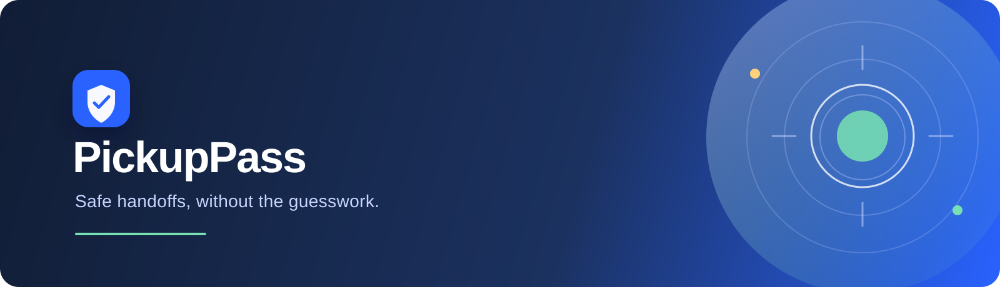

# PickupPass



PickupPass is a calm, auditable pickup-verification workflow for childcare centers, schools, and care teams. When a visitor arrives, a coordinator confirms the authorized person, validates a one-time claim code, and records the decision before releasing a child.

The product is built around one principle: a camera event is evidence that someone arrived—not permission to release.

Source: [github.com/sandman-sh/PickupPass](https://github.com/sandman-sh/PickupPass)

## What it does

- Receives Ring arrival events with device, location, event type, and timestamp context.
- Presents a focused front-desk decision surface for the next handoff.
- Validates claim codes and pickup windows on the server.
- Blocks invalid, early, expired, and duplicate releases.
- Supports guardian escalation when identity cannot be verified.
- Keeps an audit trail with policy status, coordinator, source evidence, and explanation.
- Uses Amazon Bedrock as an optional explanation layer while the deterministic policy engine remains authoritative.

## Quick start

Requirements: Node.js 20 or newer.

```bash
npm install
npm start
```

Open [http://localhost:4173](http://localhost:4173).

The local development path works without external credentials:

1. Select **Review arrival**.
2. Choose **Maya Patel**.
3. Enter `4829`.
4. Select **Verify & decide**.
5. Use **Simulate Ring arrival** to exercise another arrival and the safe rejection path.

### Demo verification values

The application includes a small built-in sample roster for local evaluation. These values are demo data only:

| Person | Child | Pickup window | Code | Expected result |
| --- | --- | --- | --- | --- |
| Maya Patel | Aarav Patel | 3:30–5:00 PM | `4829` | Approved during the active window |
| Jordan Lee | Noah Lee | 4:00–6:00 PM | `1936` | Approved during the active window |
| Sam Rivera | Lena Rivera | 3:00–4:30 PM | `7714` | Approved during the active window |

To test a safe rejection, choose any person and enter a different four-digit value such as `0000`. The server records the failed verification and prevents release. The claim codes are intentionally kept out of the browser state and are never real credentials.

## Ring Developer integration

PickupPass uses the documented Ring Developer API, OAuth 2.0 account linking, and signed webhooks.

| Capability | Endpoint | Purpose |
| --- | --- | --- |
| Device discovery | `GET /api/ring/devices` | Calls the Ring API with a server-side bearer token. |
| OAuth token exchange | `POST /api/ring/oauth/token` | Receives an authorization code from Ring and exchanges it at `https://oauth.ring.com/oauth/token`. |
| Link status | `GET /api/ring/oauth/status` | Reports connection state without exposing credentials. |
| Event receiver | `POST /api/ring/webhook` | Verifies HMAC signatures, normalizes events, and deduplicates request IDs. |
| Offline development | `POST /api/ring/simulator/event` | Deterministic local fallback when a Ring staging account is unavailable. |

The local simulator is deliberately labeled as a development fallback. The official staging path uses a Ring Developer Portal application, a Ring test account, the token-exchange URL, and the webhook URL.

Configure the Ring Developer Portal with publicly reachable HTTPS endpoints:

```text
Token Exchange URL: https://your-domain.example/api/ring/oauth/token
Webhook URL:        https://your-domain.example/api/ring/webhook
```

Configure server-side environment variables:

```powershell
$env:RING_CLIENT_ID="your-ring-client-id"
$env:RING_CLIENT_SECRET="your-ring-client-secret"
$env:RING_HMAC_KEY="your-webhook-signing-secret"
$env:RING_API_BASE_URL="https://api.amazonvision.com"
npm start
```

For a short-lived developer token, `RING_ACCESS_TOKEN` can be set instead. Never place Ring credentials in browser code or commit them to the repository.

The official Ring documentation describes the API, staging users, OAuth flow, device discovery, and webhook delivery:

- [Ring Developer Experience](https://developer.amazon.com/docs/ring/get-started.html)
- [Ring API Development Guide](https://developer.amazon.com/docs/ring/develop.html)
- [Ring API reference](https://developer.amazon.com/docs/ring/api-documentation.html)

## Amazon Bedrock explanation layer

The policy engine decides the outcome. Bedrock may explain the already-computed result in two short sentences; it cannot authorize a release or change the policy result.

Enable the live explanation path on the server:

```powershell
$env:AWS_REGION="us-east-1"
$env:BEDROCK_ENABLED="true"
$env:BEDROCK_MODEL_ID="amazon.nova-lite-v1:0"
npm start
```

When AWS credentials or network access are unavailable, PickupPass automatically displays a local explanation so the core workflow remains usable.

## Decision flow

```text
Ring event
    → normalized source and device evidence
    → pending arrival
    → person and claim-code selection
    → server-side policy evaluation
    → optional Bedrock explanation
    → approval, rejection, or escalation
    → timestamped audit record
```

## API surface

- `GET /api/state` — roster, recent events, pending arrival, integration state, and Bedrock state.
- `POST /api/verify` — evaluates a claim code and records the decision.
- `POST /api/resolve` — escalates an unresolved arrival to a guardian.
- `GET /api/ring/devices` — discovers Ring devices through the live API.
- `POST /api/ring/oauth/token` — exchanges a Ring authorization code server-side.
- `GET /api/ring/oauth/status` — returns safe connection metadata.
- `POST /api/ring/webhook` — verifies and accepts Ring events.
- `POST /api/ring/simulator/event` — creates a deterministic local arrival.

## Project structure

```text
server.js                     HTTP server and application routes
ring-client.js                Ring API, OAuth, token refresh, and webhook adapter
policy.js                     Authoritative pickup policy engine
bedrock-explainer.js          Optional Bedrock explanation layer
public/                       Browser interface
data/                         Local event fixtures and runtime state
docs/product-build/           Product, architecture, feedback, and demo notes
```

## Safety and privacy

- Authorization is performed on the server, never in browser code.
- The app does not use face recognition.
- The policy engine is deterministic and remains authoritative when Bedrock is enabled.
- Ring and AWS credentials stay on the server.
- Runtime token storage is ignored by Git and is never intended for source control.

## License

PickupPass is released under the [MIT License](LICENSE).
